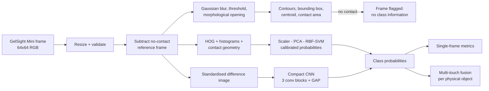

# TactileSense AI

**Supervised learning on real vision-based tactile sensor images: OpenCV preprocessing, a HOG + SVM baseline
and a compact PyTorch CNN, evaluated on held-out physical objects.**

TactileSense AI takes one RGB frame from a GelSight Mini tactile sensor and predicts which 3D-printed digit (0-9)
the sensor was pressed against. The project covers the whole supervised learning workflow for a vision-based
tactile sensor:

- OpenCV preprocessing and contact segmentation
- hand-crafted features and a classical baseline
- a learned CNN representation
- leakage-free data splitting
- honest evaluation, including the cases where the models fail
- a Streamlit demo

> **Result in one line:** on 100 unseen physical objects, both models identify the digit from a *single* touch with
> ~17% accuracy (chance 10%, both significantly above it, neither significantly better than the other). Averaging
> 32 touches of the same object raises this to 32-36%.
>
> **Evidence:**
> - [results/](results/README.md): metrics, plots, example images, demo screenshots
> - [project document](results/documentation/TactileSense_AI_Project_Document.md)
> - [demo script](results/demo/demo_script.md)

This is an independent portfolio project. It uses a public dataset; no physical tactile sensor was used by the author.

---

## Why tactile sensing matters in robotics

Cameras see an object, but a gripper *feels* it. Vision-based tactile sensors such as GelSight and DIGIT put a camera
behind a soft, illuminated elastomer gel. When the gel touches an object, its surface deforms and the internal
camera records the change in shading. The result is a high-resolution image of the contact geometry. It tells a robot
what it is touching, where the contact is and how the object sits in the hand, even when the contact point is
hidden from external cameras. Turning these images into reliable predictions is a supervised learning problem.
This project builds that pipeline end to end.

## System architecture



**ML workflow:** download the data, then validate it (decodability, duplicates, label consistency, class balance).
Split by **physical object**, so the official test objects are never seen in training. Estimate the no-contact
reference on training frames only and drop frames with no contact. Train the HOG + SVM and the CNN, selecting the
CNN checkpoint by validation accuracy. Then evaluate both saved checkpoints once on the held-out test set.

## Dataset

| | |
|---|---|
| Dataset | [Real Tactile MNIST](https://huggingface.co/datasets/TimSchneider42/tactile-mnist-touch-real-single-t256-64x64) (64x64 single-frame version) |
| Sensor | GelSight Mini (markerless) on a Franka Research 3 robot arm |
| Content | 600 3D-printed MNIST digits x 256 touches = **153,600 frames** |
| Label | digit class (0-9) of the touched object, from the dataset's `label` column |
| Balance | 15,360 frames per class (imbalance ratio 1.0); 0 undecodable and 0 duplicate frames found |
| License | CC-BY-2.0 |
| Citation | T. Schneider et al., *Tactile MNIST: Benchmarking Active Tactile Perception*, arXiv:2506.06361, 2025 |

**Important property of the data.** Each touch was made at a random position inside a 12x12 cm cell, so most
touches land on the rubber mat *next to* the digit. Those frames show an undeformed gel and carry no information
about the class. A touch that does hit the digit usually sees only a fragment of one stroke. Single-frame
classification is therefore much harder than ordinary MNIST, and this is reflected in the results.

The image-based contact detector was sanity-checked against an independent physical signal: the gel height at
touch time from the robot's kinematics. Over all 25,600 test frames, the detected contact area correlates with gel
height at **Pearson r = 0.59** ([plot](results/plots/contact_vs_gel_height.png)), as expected if the detector
responds to real contact. Gel height is used only for this check, never as a model input.

Download and preparation: see [data/README.md](data/README.md).

### Splits (no leakage between physical objects)

| Split | Objects | Frames | Frames with detected contact (used) |
|---|---|---|---|
| Train | 400 | 102,400 | 29,968 (29%) |
| Validation | 100 | 25,600 | 7,434 (29%) |
| Test (official, held out) | 100 | 25,600 | 7,798 (30%) |

- The **test split is the dataset's official test split**: 100 objects, 10 per class, none of which appear in training.
- Validation is a 20% split of the 500 official training objects, **grouped by `object_id`** and stratified by class.
  All 256 touches of an object therefore stay in one split, which `assert_no_leakage` checks on every run.
- The test set is only used by `src/evaluate.py`, after model selection on validation.

## OpenCV preprocessing pipeline


| Step | Operation | Why |
|---|---|---|
| Load / validate | `cv2.imdecode`, dtype/shape checks, grey/BGRA to BGR | robust to corrupt files and non-ASCII paths |
| Resize | `cv2.resize`, `INTER_AREA` when shrinking | consistent resolution without aliasing the gel texture |
| Colour spaces | BGR to RGB / grey / HSV | display, intensity statistics, inspecting which LED channel responds |
| Reference subtraction | pixel-wise median of 5,000 training frames | removes the static LED illumination gradient; only deformation remains |
| Denoising | Gaussian blur (5x5) | suppresses sensor noise and gel texture before thresholding |
| Segmentation | fixed threshold on max channel difference + morphological opening | a fixed threshold (not Otsu) avoids "finding" contact in an untouched gel |
| Geometry | `findContours`, `boundingRect`, image moments | contact area, number of blobs, bounding box, centroid |
| Normalisation | min-max for display; per-channel standardisation for the CNN | stable optimisation |

Optical flow and marker tracking are not implemented. The dataset contains single frames of a markerless gel, so
there are no sequences or markers to track.

## Models

**Prediction target:** 10-class digit label (integer 0-9) of the touched object, one prediction per frame.
Force, slip and pose are **not** estimated: the dataset has no labels for them.

### Model A: HOG + SVM baseline (`src/feature_extraction.py`, `src/models.py`)
- Features, 1,792 dimensions, all computed on the reference-subtracted image:
  - HOG of the signed grey difference (8x8 cells, 16x16 blocks, 9 bins)
  - a 16-bin histogram of the deformation magnitude
  - per-channel difference mean and standard deviation
  - contact geometry: area, blob count, bounding-box size, centroid
- Model: `StandardScaler` → `PCA(128)` → RBF `SVC(C=10)`, with sigmoid-calibrated probabilities
  (`CalibratedClassifierCV`).
- Trained on a class-balanced subsample of 15,000 contact frames, because kernel SVM training scales quadratically.

### Model B: compact CNN (`src/models.py`, `src/train.py`)
- Input: standardised 3-channel difference image (frame minus reference).
- Network: 3 VGG-style blocks (32/64/128 channels, conv-BN-ReLU x2 + max-pool), then global average pooling,
  dropout 0.3 and a linear layer. **288,746 parameters**; trains on a laptop CPU.
- Training:
  - cross-entropy loss, AdamW (lr 1e-3, weight decay 1e-4), batch size 128
  - ReduceLROnPlateau scheduler and early stopping (patience 5, max 25 epochs), both on validation accuracy
  - fixed seeds for reproducibility
- The checkpoint with the **highest validation accuracy** is saved, not the last epoch (`selection_metric` in
  `config.yaml`). Validation loss rose through over-confidence while accuracy was still improving, so loss-based
  selection would have kept a worse epoch-2 model.
- Augmentation is restricted to physically plausible changes:
  - random translation of ±4 px. The touch position is random anyway, and zero padding means "no deformation".
  - ±15% contact-signal scaling, to cover pressure and gel variation.
- **No flips or rotations.** The LED illumination direction is fixed relative to the sensor, and mirrored strokes
  change the digit's meaning.

## Results

All numbers come from the final run (`reports/metrics.json`, copied to [results/metrics/](results/metrics)).
The test set is the **official test split: 100 physical objects never used for training or model selection**,
of which 7,798 frames show detected contact. CIs are 95% bootstrap intervals over the 100 test **objects**,
because frames of one object are correlated.

| Held-out test set | CNN | HOG + SVM |
|---|---|---|
| Accuracy, single frame (chance = 0.10) | **0.174** [0.141, 0.208] | **0.171** [0.146, 0.201] |
| Macro precision | 0.187 | 0.170 |
| Macro recall | 0.181 | 0.183 |
| Macro-F1 | **0.181** [0.142, 0.208] | **0.159** [0.138, 0.174] |
| Accuracy on all 25,600 frames incl. no-contact | 0.109 | 0.116 |
| Object accuracy, 8 touches averaged | 0.265 | 0.301 |
| Object accuracy, 32 touches averaged | 0.316 | 0.359 |
| Training data | 29,968 frames | 15,000 frames (subsample) |
| Training time (laptop CPU) | ~66 min, 16 epochs, best = epoch 11 | 82 s fit + 69 s features |
| Latency, 1 image incl. preprocessing, 1 CPU thread (median / p95) | 6.44 / 9.54 ms | 4.96 / 7.07 ms |

Latency was measured with `time.perf_counter` over 200 single-image `predict()` calls after 5 warm-up calls,
with `torch.set_num_threads(1)`. It covers resize, preprocessing or feature extraction, and the model.


| CNN confusion matrix | HOG + SVM confusion matrix |
|---|---|
|  |  |

### What the results mean

- **Both models learn real tactile signal.** Their CIs lie above the 0.10 chance level.
- **The CNN does not beat the classical baseline on this test set.** The CNN − SVM difference intervals contain 0:
  accuracy [−0.034, +0.041], macro-F1 [−0.011, +0.053]. The CNN's higher macro-F1 is within noise. The SVM fuses
  slightly better across touches, but 100 test objects cannot separate them either.
- **The information in a single touch is the bottleneck.** A touch typically sees a fragment of one stroke, so
  "1"/"4"/"9" and "3"/"5" are frequently confused. Averaging probabilities over more touches of the same object
  steadily improves accuracy ([fusion curve](results/plots/multi_touch_fusion.png)). This matches what the dataset
  was designed for: multi-touch active perception.
- **The CNN overfits despite augmentation.** Training accuracy reached 0.45 while validation peaked at 0.19
  ([curves](results/plots/training_curves.png)).

### The weak HOG + SVM baseline, investigated (validation split only)

| Variant (6,000 training frames, same Scaler → PCA → SVM) | Train acc. | Val acc. |
|---|---|---|
| All hand-crafted features | 1.000 | 0.161 |
| HOG only | 1.000 | 0.165 |
| Contact statistics only (28-D) | 0.538 | 0.122 |
| Raw 16x16 difference pixels (control) | 0.822 | 0.113 |
| Leaky control: same features, random frame-level split | 1.000 | 0.236 |

The baseline **memorises training objects** (100% train accuracy) and generalises poorly. HOG carries the useful
signal; contact statistics and raw pixels are near chance. The leaky control shows why splitting by object is
essential: a frame-level split would report **0.236 instead of 0.161** (+46% relative), purely from leakage.
Produced by `python scripts/analyze_baseline.py`.

### Failure case


**What happened:** the most confident wrong CNN prediction on the test set. A true **6** was classified as **8
with 99.7% confidence**; the SVM said 3 at 17.6%.

**Why:**
- **There is no digit stroke in the frame.** It shows a broad, diffuse change, which the threshold-based detector
  counts as 14% contact.
- **The robot measured a low gel height.** It was 4.75 mm, below the 10th percentile of test contact frames
  (6.08 mm; median 8.71 mm). The sensor most likely pressed the rubber mat beside the digit. So this is a
  **contact-detector false positive**, followed by a CNN that is confidently wrong on an image with no class evidence.

**The general pattern:** CNN predictions with confidence ≥ 0.9 are correct only **18.8%** of the time (96 test
frames), so its confidence is not calibrated. The SVM's calibrated probabilities never exceed 0.3: less
informative, but not misleading.

More examples: [correct CNN predictions](results/images/examples_cnn_correct.png),
[CNN failures](results/images/examples_cnn_failures.png).

## Installation and usage

Tested with Python 3.14.6 on Windows 11, CPU only.

```bash
python -m venv .venv
```
```bash
.venv\Scripts\activate
```
(On Linux/macOS: `source .venv/bin/activate`.)
```bash
pip install -r requirements.txt
```

Prepare the data (~133 MB download):
```bash
python scripts/prepare_data.py
```

Train both models and evaluate on the held-out test set:
```bash
python scripts/run_experiments.py
```

Or run the steps separately:
```bash
python -m src.train
```
```bash
python -m src.evaluate
```

Diagnose the baseline (validation split only):
```bash
python scripts/analyze_baseline.py
```

Rebuild the `results/` package (metrics, plots, example images, bootstrap CIs) from the saved outputs:
```bash
python scripts/build_results.py
```

Fast end-to-end software check on a small subset. It writes to `models/smoke/` and `reports/smoke/`; its metrics are
**not** results.
```bash
python scripts/run_experiments.py --smoke
```

Run the tests (synthetic fixtures; no dataset needed):
```bash
python -m pytest -q
```

Launch the demo (needs trained models):
```bash
streamlit run app.py
```

All settings (image size, thresholds, HOG parameters, SVM and CNN hyper-parameters, paths) live in
[config.yaml](config.yaml). All paths are relative to the repository root.

## Demo

`streamlit run app.py` opens a page where you can:
- pick a held-out test frame by digit, or upload a tactile image
- see the raw frame, the reference, grey/HSV views, the difference map and the contact overlay
- read the contact area, blob count and centroid
- compare CNN and HOG + SVM predictions with their class probabilities

The app warns when no contact is detected, because the prediction is then meaningless. It shows a clear message
when no trained model is available. Test-set examples come from `models/demo_examples.npz`: 50 held-out contact
frames per digit, written by `src/evaluate.py`.


*Screenshot of the running app with the final models: here the CNN is right and the SVM is wrong. Both are wrong on
many other frames. Video plan: [results/demo/demo_script.md](results/demo/demo_script.md).*

## Project structure

```
app.py                     Streamlit demo
config.yaml                all configuration
src/
  config.py                config loading, logging, seeding
  data_loader.py           parquet + folder-per-class loaders, validation, grouped splits, caching
  preprocessing.py         OpenCV pipeline and contact segmentation
  feature_extraction.py    HOG / histogram / contact-geometry features
  models.py                SVM pipeline and CNN
  train.py                 training of both models, checkpointing
  evaluate.py              held-out evaluation, latency, multi-touch fusion, figures
  inference.py             TactilePredictor used by evaluation and the demo
  visualization.py         Matplotlib figures
scripts/
  prepare_data.py          download + validate + cache
  run_experiments.py       train + evaluate (full or --smoke)
  analyze_baseline.py      validation-only diagnosis of the baseline
  build_results.py         assembles results/ from the saved outputs
tests/                     pytest suite with clearly labelled synthetic fixtures
results/                   final metrics, plots, images, demo script and project documentation
data/README.md             dataset documentation
```

## Known limitations

- **Single frames are ambiguous.** A touch usually covers a fragment of one stroke, and ~70% of touches miss the
  digit entirely. Single-frame accuracy is therefore bounded by the data, not only by the model.
- **One sensor, one set-up.** The no-contact reference and the models are specific to GelSight Mini images from
  this dataset. Other sensors, gels or lighting need a new reference and retraining.
- **Low resolution.** The 64x64 version was chosen for CPU training; the 320x240 frames contain more detail.
- **Contact segmentation uses a fixed threshold.** It is validated against gel height (r = 0.59), but it misses
  light contacts and can fire on diffuse deformation from the mat (see the failure case).
- **The CNN's confidence is not calibrated.** Predictions at ≥ 0.9 confidence are right only 18.8% of the time.
- **Small test set at the object level.** There are 100 test objects, so differences of a few percentage points
  between models are not statistically resolvable.
- **Offline only.** There was no real-time integration with a robot and no physical hardware testing.

## Future work

- Fuse sequences of touches together with the touch position known from the robot (active perception).
- Calibrate the CNN (temperature scaling) and replace the fixed-threshold contact detector with a learned one.
- Train at 320x240 and use self-supervised tactile pre-training (e.g. Sparsh-style encoders).
- Regress contact pose or force on datasets that provide those labels.
- Test on a physical GelSight/DIGIT sensor.

## Citation

```bibtex
@article{schneider2025tactilemnist,
  title   = {Tactile MNIST: Benchmarking Active Tactile Perception},
  author  = {Schneider, Tim and others},
  journal = {arXiv preprint arXiv:2506.06361},
  year    = {2025}
}
```
