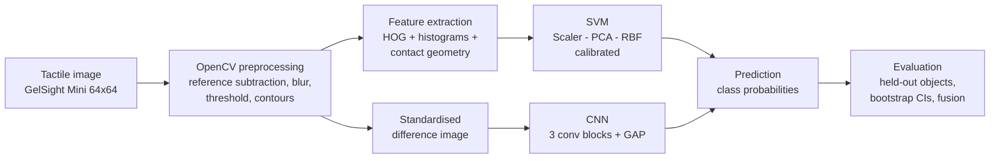
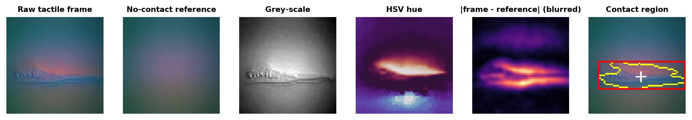
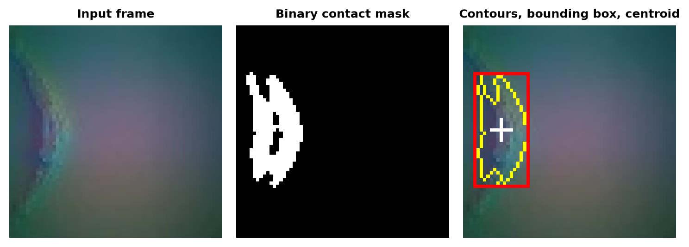
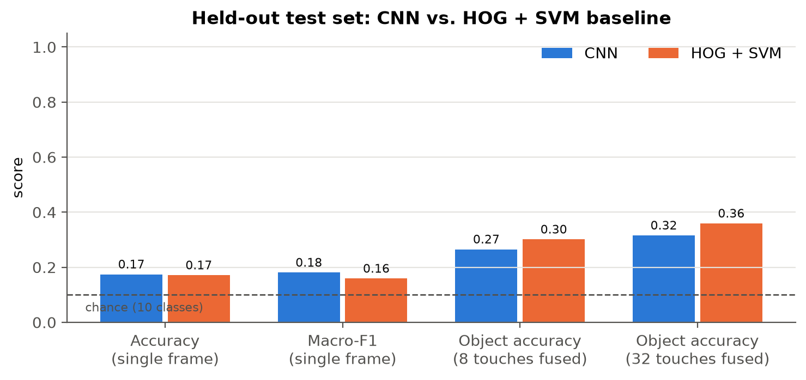
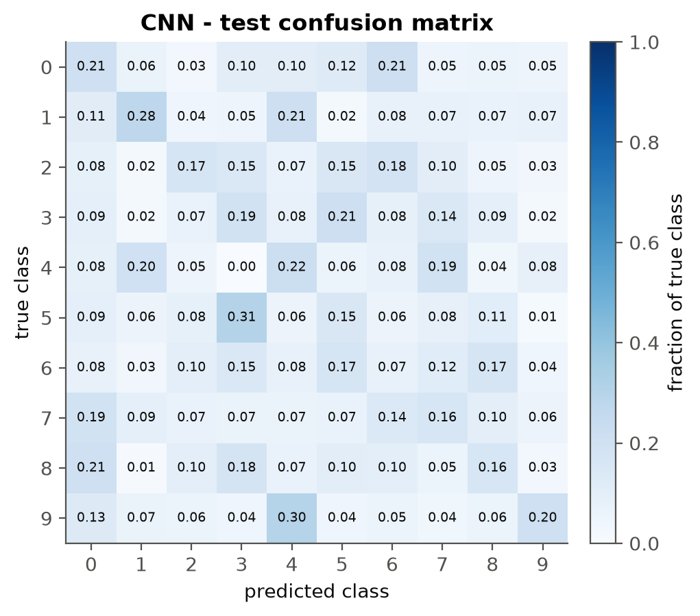
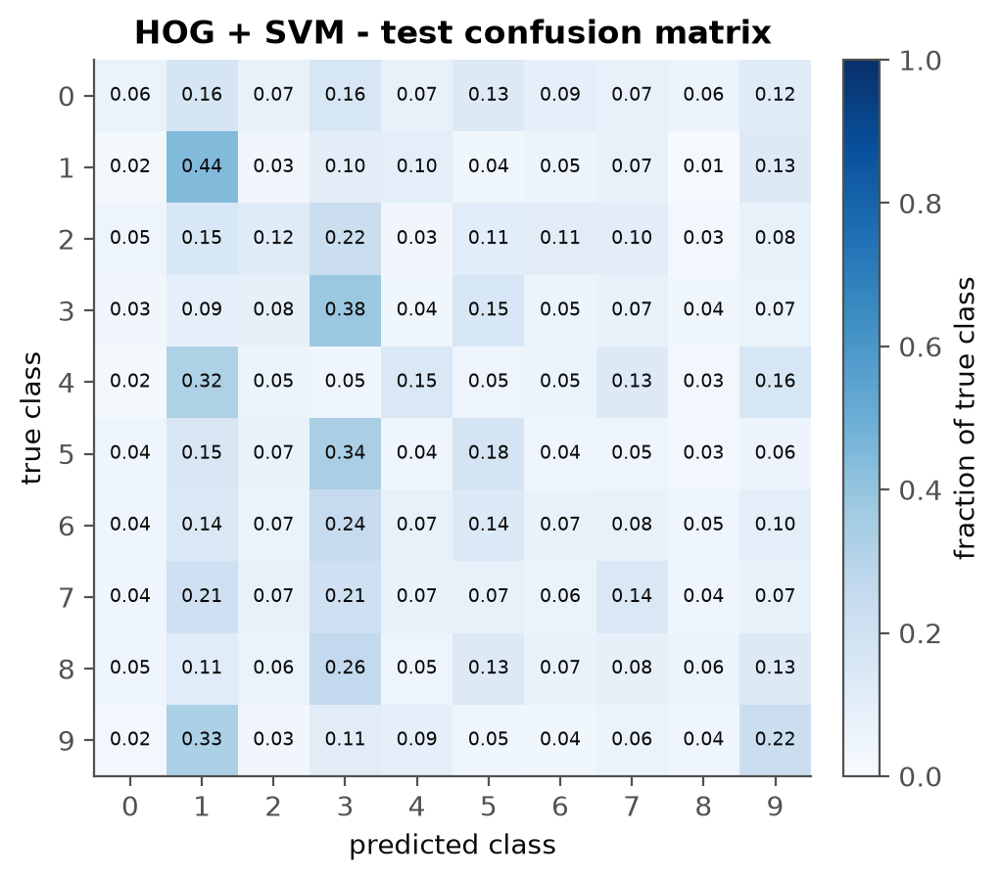
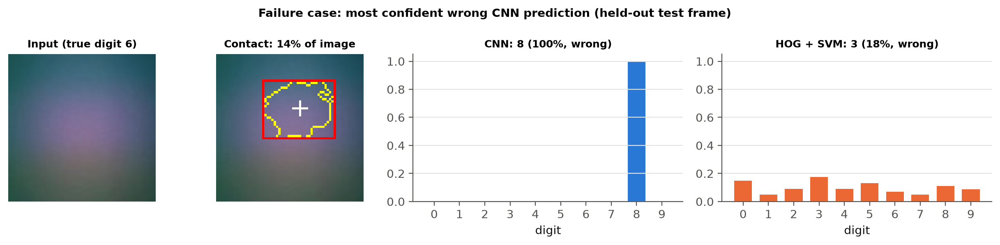
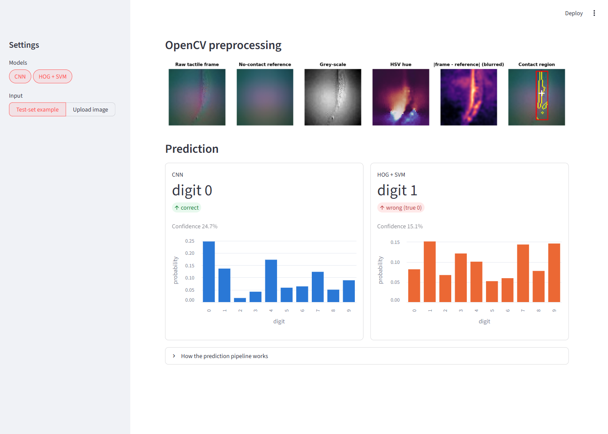

# TactileSense AI: Vision-Based Tactile Perception

*Independent portfolio project by Sreya Thota. Not affiliated with or endorsed by DLR. Code:
github.com/SreyaThota/tactile-sense-ai (private).*

## 1. Project overview

TactileSense AI classifies images from a vision-based tactile sensor (GelSight Mini). Given one tactile frame, it
predicts which 3D-printed digit the sensor was pressed against. The project builds the complete supervised learning
pipeline:
- OpenCV preprocessing and contact segmentation
- a hand-crafted HOG + SVM baseline
- a compact PyTorch CNN
- leakage-free evaluation on unseen physical objects
- a Streamlit demo

The relevant robotics question is how much a robot can infer about an object from a single touch, and how quickly
that improves with more touches.

## 2. Problem statement

A camera sees the outside of an object. A gripper with a vision-based tactile sensor sees the *contact itself*:
- a camera behind an illuminated gel records how the gel deforms
- the result is a high-resolution image of the local geometry, even where external cameras are occluded

Interpreting these images is what turns a soft fingertip into a perception system for grasping, in-hand
manipulation and object recognition. They are images, so OpenCV and supervised learning apply directly. However,
they look nothing like natural photos, so the preprocessing, augmentation and evaluation choices need physical
justification.

## 3. Technical architecture



## 4. OpenCV pipeline



1. **Load and validate** with `cv2.imdecode`: dtype and shape checks; grey and BGRA images are converted to BGR.
2. **Resize** to 64x64 with `INTER_AREA`, which avoids aliasing.
3. **Inspect colour spaces:** RGB for display, grey for statistics, HSV hue to see which LED channel responds.
4. **Reference subtraction.** The pixel-wise median of 5,000 *training* frames estimates the undeformed gel.
   Subtracting it removes the static LED illumination, leaving only deformation.
5. **Denoise** with a 5x5 Gaussian blur.
6. **Segment contact:**
   - fixed threshold (15) on the max channel difference
   - 3x3 morphological opening
   - frames below 2% contact area count as "no contact"
   - a fixed threshold, not Otsu, is used so that an untouched gel does not produce a fake contact
7. **Extract geometry:** `findContours`, `boundingRect`, image moments for the centroid, and contact area.
8. **Normalise:** min-max for display; per-channel standardisation of the difference image for the CNN.
9. **HOG** (`cv2.HOGDescriptor`, 8x8 cells, 9 bins) on the grey difference image, for the baseline.



**Validation of the contact detector.** The detected contact area correlates with the gel height measured by the
robot (Pearson r = 0.59 over all 25,600 test frames; [plot](../plots/contact_vs_gel_height.png)). Height is
used only for this check, never as a model input.

## 5. Machine learning models

**Target:**
- 10-class digit label (integer 0-9), one prediction per frame
- no force, slip or pose estimation: the dataset has no such labels

| | HOG + SVM baseline | CNN |
|---|---|---|
| Input | 1,792-D hand-crafted features: HOG, deformation histogram, colour statistics, contact geometry | 3x64x64 standardised difference image |
| Model | StandardScaler → PCA(128) → RBF-SVC (C=10), sigmoid-calibrated probabilities | 3 VGG-style blocks (32/64/128 channels, BatchNorm), global average pooling, dropout 0.3; 288,746 parameters |
| Training data | 15,000 class-balanced contact frames | 29,968 contact frames |
| Training | 82 s fit + 69 s feature extraction | AdamW (lr 1e-3), cross-entropy, ReduceLROnPlateau, early stopping; best of 16 epochs = epoch 11 (val acc 0.190) |
| Augmentation | none | ±4 px shifts and ±15% signal scaling only; no flips or rotations, because the illumination direction is fixed and mirrored strokes change the digit |

## 6. Dataset and experimental setup

- **Source:** Real Tactile MNIST (Schneider et al., *Tactile MNIST: Benchmarking Active Tactile Perception*,
  arXiv:2506.06361, 2025). Hugging Face dataset `TimSchneider42/tactile-mnist-touch-real-single-t256-64x64`,
  **CC-BY-2.0**.
- **Collection:** a Franka robot pressed a GelSight Mini at random positions over 600 3D-printed digits, with 256
  touches per digit: **600 objects, 153,600 frames**, 15,360 per class. No undecodable or duplicate frames were found.
- **Splits, grouped by physical object:**

| Split | Objects | Frames | Contact frames used |
|---|---|---|---|
| Train | 400 | 102,400 | 29,968 |
| Validation | 100 | 25,600 | 7,434 |
| Test (official) | 100 | 25,600 | 7,798 |

- **Limitations of the data:**
  - Only ~30% of touches hit the digit; the rest show bare gel and are excluded.
  - Thin digits receive fewer contacts: in the test set, 494 contact frames for "1" versus 919 for "6" and "8".
  - One sensor model; 64x64 resolution.

## 7. Results (held-out test set, 100 unseen objects)

| Metric | CNN | HOG + SVM |
|---|---|---|
| Accuracy (chance 0.10) | 0.174 [0.141-0.208] | 0.171 [0.146-0.201] |
| Macro-F1 | 0.181 [0.142-0.208] | 0.159 [0.138-0.174] |
| Object accuracy, 32 touches averaged | 0.316 | 0.359 |
| Latency, 1 image, 1 thread (median) | 6.4 ms | 5.0 ms |

*Brackets: 95% bootstrap CIs over test objects.*



| CNN | HOG + SVM |
|---|---|
|  |  |

**Main finding:**
- **Both models learn real signal.** Their CIs lie above chance.
- **Neither is better on this test set.** The CNN − SVM difference intervals include 0.
- **The limiting factor is the information in one touch, not the classifier.** Averaging 32 touches of an object
  doubles accuracy to 0.32-0.36.
- **The baseline memorises training objects.** A validation-only diagnosis shows 100% training versus 16%
  validation accuracy.
- **Splitting by frame instead of by object would have inflated** the baseline from 0.161 to 0.236.

**Failure case:**
- **What happened:** a true "6" was classified as "8" with **99.7%** CNN confidence.
- **Why:** the frame has no stroke edges, and the robot's gel height (4.75 mm) is below the 10th percentile of
  contact frames. The sensor most likely pressed the mat, and the contact detector produced a false positive.
- **The general pattern:** CNN predictions with ≥ 0.9 confidence are right only 18.8% of the time, so its
  confidence must not be trusted without calibration.



## 8. Demo

```bash
streamlit run app.py
```

Pick a digit (or upload a GelSight Mini frame) and press **Another example**. The app shows:
- the raw frame, contact area, blob count and centroid
- the OpenCV preprocessing row
- CNN and HOG + SVM predictions with probability bars and a correct/wrong indicator against the true label

It warns when no contact is detected.



## 9. Limitations and next steps

- **Limitations:**
  - single-frame ambiguity
  - offline inference only, with no physical sensor or robot in the loop
  - one sensor type and gel appearance
  - low resolution (64x64)
  - fixed-threshold contact detection, which gave the false positive above
  - uncalibrated CNN confidence
- **Next steps:**
  - fuse touch sequences, and use the touch position the robot knows
  - temperature scaling for calibration
  - train at 320x240
  - self-supervised tactile pre-training
  - a learned contact detector
  - validation on a physical GelSight/DIGIT sensor

## 10. Reproducibility

```bash
pip install -r requirements.txt
python scripts/prepare_data.py          # download ~133 MB, validate, cache
python scripts/run_experiments.py       # train both models + evaluate on the test set
python scripts/analyze_baseline.py      # validation-only baseline diagnosis
python scripts/build_results.py         # rebuild this results/ package
python -m pytest -q                     # 26 tests, synthetic fixtures
streamlit run app.py                    # demo
```

Fixed seed (42). Tested on Python 3.14.6, Windows 11, CPU only. CNN training took ~66 min wall-clock on a laptop
CPU.

## 11. Relevance to the DLR working-student position

The project practises the skills the role asks for, on real tactile data:
- **OpenCV:** reference subtraction, filtering, segmentation, contours and HOG, with the contact detector checked
  against a physical measurement.
- **Supervised learning:** a classical baseline and a CNN, with physically justified augmentation and validation-based
  model selection.
- **Data preparation:** label-consistency, duplicate and balance checks, and object-grouped splits with an automatic
  leakage check.
- **Evaluation:** bootstrap CIs, confusion matrices, a fusion analysis, a calibration check and an analysed failure.
- **Software engineering:** typed, tested and configurable Python with reproducible scripts and a demo.

It is an independent project and makes no claim of affiliation with DLR.
